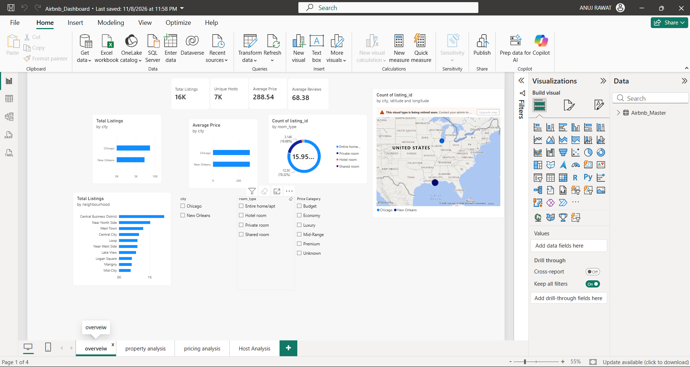
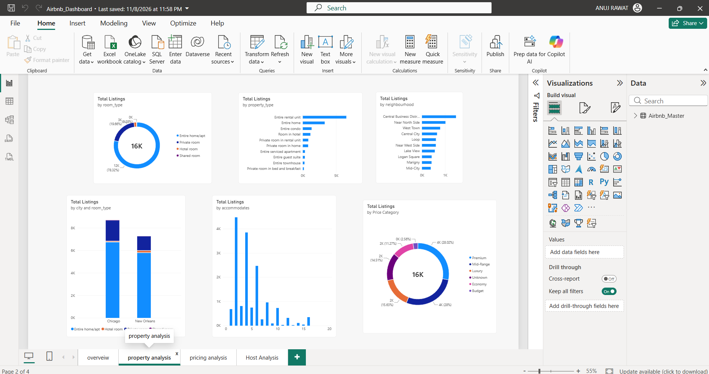
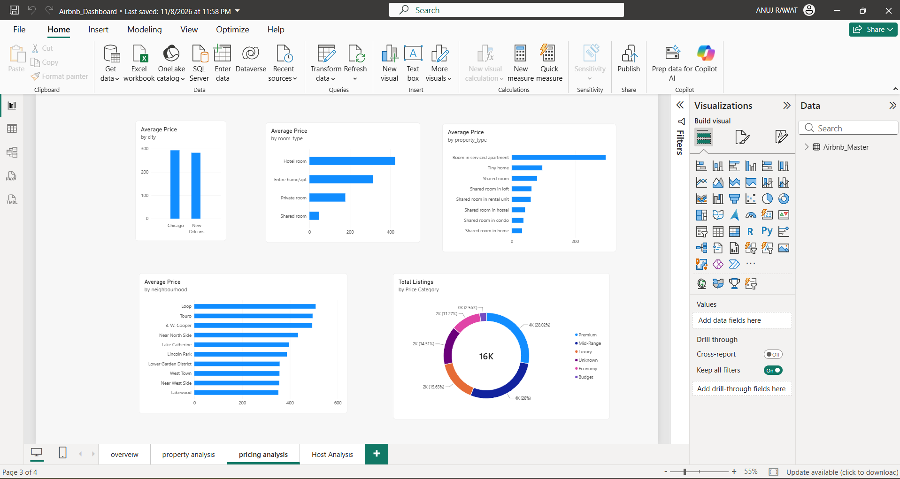
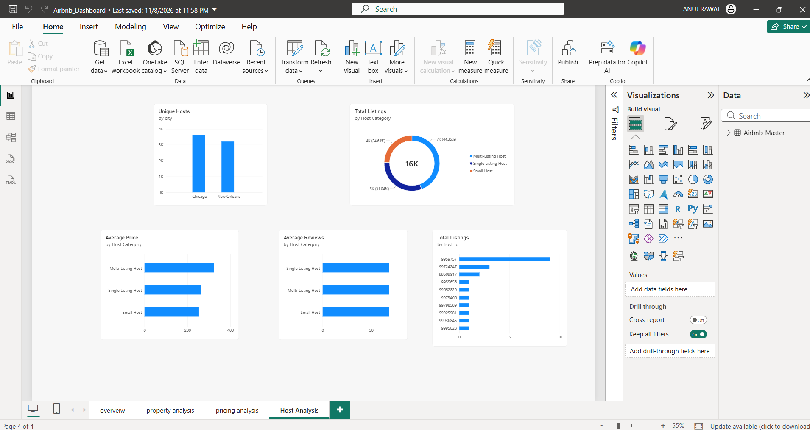

# Airbnb Listings Analysis | Chicago vs New Orleans

### Exploratory Data Analysis & Interactive Power BI Dashboard

An end-to-end Data Analytics and Business Intelligence project comparing Airbnb listings across **Chicago** and **New Orleans** using Python, Pandas, Google Colab, and Microsoft Power BI.

The project focuses on understanding listing distribution, pricing trends, neighbourhood popularity, property characteristics, and host behaviour through exploratory analysis and interactive visualizations.

---

## Project Overview

This project transforms raw Airbnb listing data into meaningful insights through data cleaning, exploratory data analysis (EDA), feature engineering, and dashboard development.

The interactive Power BI dashboard contains four analytical pages:

1. Overview
2. Property Analysis
3. Pricing Analysis
4. Host Analysis

**Dataset:** Inside Airbnb  
**Cities:** Chicago and New Orleans  
**Total Listings:** 15,958  
**Dashboard Platform:** Microsoft Power BI

---

## Business Objectives

- Compare the Airbnb market across Chicago and New Orleans.
- Identify neighbourhoods with the highest listing concentrations.
- Analyze the distribution of property types and room types.
- Examine pricing variations across locations and accommodation types.
- Compare host categories based on listing counts, prices, and reviews.
- Develop an interactive dashboard to support exploratory business analysis.

---

## Tech Stack

| Technology | Purpose |
|---|---|
| Python | Data processing and analysis |
| Pandas | Data cleaning and transformation |
| NumPy | Numerical operations |
| Matplotlib | Data visualization |
| Seaborn | Exploratory visualizations |
| Google Colab | Notebook development and execution |
| Power BI | Interactive dashboard development |
| DAX | Calculated measures and categories |
| GitHub | Project documentation and version control |

---

## Dataset Information

The analysis combines two Airbnb listings datasets.

| City | Listings | Unique Hosts | Neighbourhoods |
|---|---:|---:|---:|
| Chicago | 8,695 | 3,635 | 76 |
| New Orleans | 7,263 | 3,208 | 70 |
| **Total** | **15,958** | | |

**Data Source:** [Inside Airbnb](https://insideairbnb.com/get-the-data/)

The dataset includes listing identifiers, host information, geographical coordinates, property types, room types, prices, reviews, and availability information.

---

## Data Cleaning and Preprocessing

The following data preparation steps were performed:

- Checked and removed duplicate listing identifiers within each city.
- Standardized relevant column names and text fields.
- Converted price strings into numeric values.
- Treated invalid and nonpositive prices as missing.
- Converted date fields into appropriate datetime formats.
- Validated availability values within the 0–365 range.
- Preserved missing values where replacing them could distort analysis.
- Combined the two city datasets into a single analytical dataset.

### Feature Engineering

Created additional analytical categories:

**Price Category:** Budget, Economy, Mid-Range, Premium, Luxury, Unknown.

**Availability Category:** Low, Medium, High, Unknown.

**Host Category:** Single Listing Host, Small Host, Multi-Listing Host, Unknown.

**Review Category:** No Reviews, Low Reviews, Medium Reviews, High Reviews, Unknown.

These categories were designed for exploratory analysis and are not official Airbnb classifications.

---

## Interactive Power BI Dashboard

The dashboard consists of four analytical pages, each focusing on a different aspect of Airbnb listings.

### 1. Overview Dashboard



**Key Visualizations:**
- Total Listings
- Unique Hosts
- Average Listing Price
- Average Reviews
- Listings by City
- Average Price by City
- Room Type Distribution
- Top Neighbourhoods

**Purpose:** Provide a high-level comparison of Airbnb listing activity across Chicago and New Orleans.

### 2. Property Analysis Dashboard



**Key Visualizations:**
- Room Type Distribution
- Property Type Distribution
- Top 10 Neighbourhoods
- Listings by City and Room Type
- Accommodation Capacity Distribution
- Price Category Distribution

**Purpose:** Explore how property characteristics and accommodation options vary across the two cities.

### 3. Pricing Analysis Dashboard



**Key Visualizations:**
- Average Price by City
- Average Price by Room Type
- Average Price by Property Type
- Average Price by Neighbourhood
- Price Category Distribution

**Purpose:** Understand differences in listing prices across locations and accommodation categories.

### 4. Host Analysis Dashboard



**Key Visualizations:**
- Unique Hosts by City
- Listings by Host Category
- Average Price by Host Category
- Average Reviews by Host Category
- Top 10 Hosts by Listing Count

**Purpose:** Explore the relationship between host listing portfolios, pricing, and review activity.

---

## Key Analytical Findings

### 1. Listing Distribution

Chicago contains more Airbnb listings than New Orleans in the analyzed datasets, with 8,695 listings compared with 7,263.

### 2. Room Type Distribution

Entire homes and apartments represent the largest share of listings, accounting for approximately 78% of the combined dataset.

### 3. Pricing Differences

Average prices vary considerably across room types. Hotel rooms show higher average prices than private and shared rooms in the combined analysis.

### 4. Neighbourhood Concentration

Listing activity is concentrated in specific neighbourhoods. The dashboard identifies high-listing-count areas and allows users to explore neighbourhood-level pricing differences.

### 5. Host Characteristics

Host categories show differences in listing counts and average prices. Multi-listing hosts represent a substantial portion of the combined listing inventory.

---

## Dashboard Features

- Interactive charts and visualizations
- City-based comparison
- Room type and price category exploration
- Neighbourhood-level analysis
- Cross-filtering between visuals
- Multiple analytical pages
- DAX-based metrics and calculations

---

## Repository Structure

```text
Airbnb-Chicago-vs-New-Orleans/
│
├── Airbnb_Chicago_vs_New_Orleans_EDA.ipynb
├── Airbnb_Dashboard.pbix
├── airbnb_chicago_new_orleans_cleaned.csv
├── data_quality_summary.csv
├── README.md
│
├── overview.png.png
├── property_analysis.png.png
├── pricing_analysis.png.png
└── host_analysis.png.png
```

---

## How to Run the Project

### Python EDA

1. Download or clone this repository.
2. Open `Airbnb_Chicago_vs_New_Orleans_EDA.ipynb` in Google Colab.
3. Upload the required original Airbnb datasets.
4. Run the notebook cells.
5. Review the exploratory visualizations and analysis.

### Power BI Dashboard

1. Install Microsoft Power BI Desktop.
2. Download `Airbnb_Dashboard.pbix`.
3. Open the file using Power BI Desktop.
4. If prompted, update the data source path to the included cleaned CSV.
5. Explore the four dashboard pages and interactive visualizations.

---

## Project Limitations

- The Chicago and New Orleans datasets were collected on slightly different dates.
- Some listings contain missing prices.
- Listing prices do not represent realized revenue.
- Calendar availability does not directly measure occupancy.
- Review counts do not directly measure current booking demand.
- Correlation between listing characteristics does not imply causation.

---

## Future Improvements

- Integrate historical Airbnb listing datasets.
- Develop time-series comparisons of listing prices.
- Introduce additional geographical visualizations.
- Add more detailed host performance metrics.
- Expand analysis to additional cities.

---

## Conclusion

This project demonstrates an end-to-end analytics workflow, from raw data preprocessing and exploratory analysis to interactive dashboard development.

By comparing Airbnb listings in Chicago and New Orleans, the project highlights differences in listing distribution, property types, pricing structures, neighbourhood concentration, and host characteristics.

The Power BI dashboard makes these findings accessible through clear visualizations and interactive exploration.

---

## Author

**Anuj Rawat**

B.Tech — Computer Science & Engineering

**Focus Areas:** Data Analytics | Python | SQL | Power BI | Business Intelligence

[GitHub Profile](https://github.com/anuj-rawat8216) | [LinkedIn](https://www.linkedin.com/in/anujr8216/)

---

*Built using Python, Google Colab, and Microsoft Power BI.*
